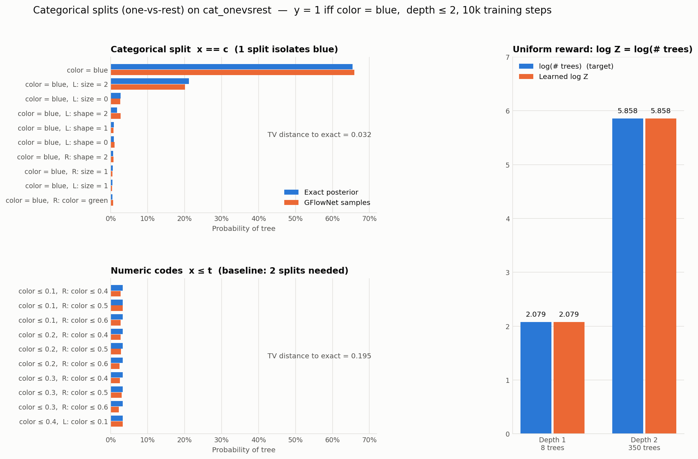
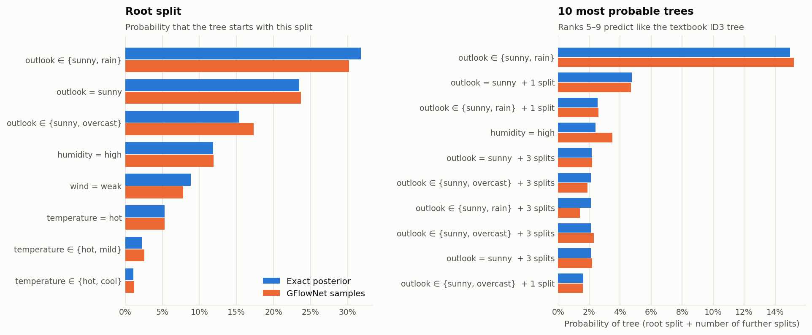

## Research question

The decision tree environment in the
[`gflownet`](https://github.com/alexhernandezgarcia/gflownet) library only
splits on numeric features, with rules $x_f \le \tau$ on min-max scaled data.
A categorical feature (e.g. a color) has to be encoded as numbers first, which
imposes an order that doesn't exist.

**Can the GFlowNet sample trees with categorical splits, and does it recover
the exact posterior over trees better than with numeric codes?**

## Methods compared

All methods share the same node structure, a `Stack` of two stages:

1. **Stage 0:** a `Choice` over features.
2. **Stage 1:** choose which categories go to the **left** child.

Every node keeps, for each feature, the set $A$ of categories that can still
reach it (computed from its ancestors: left child $A\cap L$, right child
$A\setminus L$). Features with $|A|<2$ are masked. To count each split once,
the first available category $\min(A)$ always goes left (mirror rule), and
$L \neq A$ so the right child is never empty.

| Method | Split | Stage 1 | Steps per split | Policy outputs |
|---|---|---|---|---|
| One-vs-rest | $x_f = c$ | `Choice` over categories | 1 | $k$ |
| One-step subsets | $x_f \in L$ | `Choice` over all subsets (bitmasks) | 1 | $2^k-1$ |
| **Sequential subsets** | $x_f \in L$ | `SubsetSequential`: add categories in increasing order, then STOP | $\lvert L\rvert+1$ | $k+1$ |

Both subset methods reach the same $2^{|A|-1}-1$ splits per feature, each
through exactly one trajectory. The sequential method scales to many
categories; one-step is capped at $k\le 10$ (1023 options).

::: {.callout-note}
The three methods were implemented and compared. The code kept going forward
(`node_type="categorical_sequential"`, in `categorical_node.py` and
`subset_sequential.py`) contains **only the sequential method**.
:::

### Why a new environment instead of `Choices`?

A split needs the **policy** to decide how many categories go left.
`Choices` always selects exactly `max_selection` options (selecting fewer is
not implemented), and even `SetFlex` takes the number of elements from
outside, per trajectory, with the global EOS valid only once every element is
done. `SubsetSequential` makes STOP a policy action, valid as soon as $L$ is
non-empty, and its increasing order gives one trajectory per subset (trivial
backward policy).

## Methodology

### Synthetic data with a planted rule

500 samples with features color (4 categories: red, blue, green, yellow),
size and shape, 5% label noise, 5 seeds, 80/20 stratified train/test split.

| Dataset | Rule |
|---|---|
| `cat_onevsrest` | $y=1$ iff color $=$ blue |
| `cat_subset` | $y=1$ iff color $\in\{\text{red},\text{green}\}$ |
| `cat_depth2` | $y=1$ iff color $=$ blue and size $=0$ |

Because we choose the rule, we know which tree should be the most probable.

### Exact posterior

Each tree has reward $R(T)=\text{prior}(T)\times p(\text{data}\mid T)$ and
the GFlowNet is trained to sample
$P(T\mid\text{data}) = R(T)/\sum_{T'}R(T')$. With 3 features and depth
$\le 2$ there are only a few hundred trees, so we **enumerate all of them**
and compute this posterior (and the true $\log Z$) exactly. We compare it with
the frequencies of $N$ GFlowNet samples using the total variation distance
$\mathrm{TV} = \tfrac12\sum_T|\hat P_{\text{GFN}}(T)-P(T\mid\text{data})|$.

### Uniform-reward test

With $R(T)=1$ for every tree, trajectory balance gives $Z=$ number of trees,
so the learned $\log Z$ must converge to $\log(\#\text{trees})$. Any other
value means some trees are unreachable or reachable by several trajectories.

## Results

All runs: depth $\le 2$, seed 1.

### Uniform reward

| Method | Depth | Trees | Target $\log Z$ | Learned $\log Z$ |
|---|---|---|---|---|
| One-vs-rest | 1 | 8 | 2.0794 | 2.0794 |
| One-vs-rest | 2 | 350 | 5.858 | 5.858 |
| One-step subsets | 2 | 659 | 6.4907 | 6.4908 |
| Sequential subsets | 2 | 659 | 6.4907 | 6.4888 |

The tree counts are also checked by an independent count that doesn't use
the environment code.

### Categorical vs numeric codes (`cat_onevsrest`, 10k steps)

| | TV to exact | Top tree | GFlowNet | Exact |
|---|---|---|---|---|
| One-vs-rest | **0.032** | color $=$ blue | 65.9% | 65.4% |
| Numeric codes ($x\le\tau$, 9 thresholds) | 0.195 | needs 2 splits | ~3% each | ~3% each |

**Why the numeric baseline spreads its probability.** With colors scaled to
red $=0$, blue $=0.33$, green $=0.67$, yellow $=1$, isolating blue needs two
cuts. Thresholds 0.1, 0.2 and 0.3 give the same red/blue cut, 0.4, 0.5 and
0.6 the same blue/green cut, and the cuts can be made in either order: at
least $3\times3\times2=18$ trees route the samples identically, so they have
the same reward and share the posterior mass (about 30 trees at $\approx3\%$).
The categorical split color $=$ blue is a single tree. The best numeric tree
also has a much lower log-posterior ($-102.62$ vs $-97.34$, about $200\times$
less likely).

### Subsets vs one-vs-rest (`cat_subset`)

| Method | TV to exact | Learned $\log Z$ | Exact $\log Z$ |
|---|---|---|---|
| One-step subsets | **0.047** | $-107.56$ | $-107.96$ |
| Sequential subsets | 0.056 | $-108.20$ | $-107.96$ |
| One-vs-rest | 0.091 | $-111.75$ | $-111.21$ |

With subset splits, the exact posterior puts 80.9% on the single tree
color $\in\{\text{red},\text{green}\}$; the sequential GFlowNet samples it at
84.2%. One-vs-rest cannot express the rule in one split: its probability is
spread over 4 two-split trees (22.5%, 22.5%, 16.6%, 16.6%), and its best tree
has a lower log-posterior ($-112.70$ vs $-108.17$).

### Real data: Play Tennis (depth $\le 3$)

Quinlan's ID3 example: 14 samples, 4 categorical features (outlook: sunny,
overcast, rain; temperature: hot, mild, cool; humidity: high, normal; wind:
weak, strong), binary label, all samples used for training. Sequential
subsets, seed 1, 10k steps.

There are 8, 380, 194,018 and about $2.7\times10^9$ trees at depth 1, 2, 3
and 4, so depth 3 is the deepest where the exact posterior can be enumerated.
The enumeration is generated directly (same recursion as the tree count) and
scored with the training proxy; at depth 2 it matches a depth-first search
through the environment (380 trees).

| | GFlowNet | Exact / best possible |
|---|---|---|
| Learned $\log Z$ | $-11.45$ | $-11.31$ |
| TV, root split | **0.026** | 0.029 (noise floor) |
| TV, whole trees | **0.316** | 0.326 (noise floor) |
| Top tree, outlook $\in\{\text{sunny},\text{rain}\}$ | 15.2% | 15.0% |

The "noise floor" is the mean TV of 1000 samples drawn from the exact
posterior itself: with 1000 samples spread over 194k trees, even a perfect
sampler has a TV of about 0.33 on whole trees. The GFlowNet is at that floor
for both metrics.

**The textbook tree is not the most probable.** The top tree is the single
split outlook $\in\{\text{sunny},\text{rain}\}$, which isolates overcast
(always play). With 14 samples, each split costs about 2.8 nats of prior,
which outweighs the better fit of deeper trees. Trees that predict exactly
like the ID3 tree (outlook, then humidity under sunny and wind under rain)
appear at ranks 5–9: the three-way outlook split can be written with binary
splits in 5 ways, each at about 2.1%, about 10.6% together.

**Accuracy is not informative on 14 samples.**

| | Accuracy |
|---|---|
| Train, mean over the 1000 sampled trees | 80.9% |
| Train, vote of the sampled trees (BMA) | 100% |
| Leave-one-out, exact posterior BMA | 50.0% |
| Leave-one-out, CART (depth $\le 3$) | 64.3% |
| Leave-one-out, majority class | 64.3% |

Leave-one-out is pathological here: the top tree's $\{\text{sunny},\text{rain}\}$
leaf holds exactly 5 yes and 5 no, so removing any one of these samples flips
the leaf's vote against it. Test accuracy needs a larger dataset.

### Takeaways

- Categorical splits recover the exact posterior much better than numeric
  codes (TV 0.032 vs 0.195).
- One-vs-rest is dominated by subset splits when the rule groups categories.
- One-step and sequential subsets perform about the same at $k=4$. Sequential
  is kept because it scales to many categories ($k+1$ outputs instead of
  $2^k-1$).
- On real data (Play Tennis, 194k trees at depth 3), the sequential GFlowNet
  samples the exact posterior up to sampling noise.

## Limitations

- Synthetic data and one tiny real dataset, one seed, small trees
  (depth $\le 3$), few categories ($k\le 4$).
- No test-set accuracy yet: Play Tennis is too small for it.
- The tree is either all-categorical or all-numeric: mixed datasets are not
  supported yet.
- `Tree.readable2state` is not implemented in the library, so readable
  round-trips are only tested at the node level.

## Next steps

| Task | Status |
|---|---|
| Play Tennis: exact posterior at depth 3 | Done |
| Tic-Tac-Toe: test accuracy vs CART and numeric codes | Next |
| Car Evaluation (ordered categories, control) | Planned |
| Seeds 2–5 and test-set metrics | Planned |
| Large-$k$ test of the sequential method | Planned |
| Mixed numeric + categorical features | Planned |

